# Actual state machine

```mermaid
stateDiagram-v2
    [*] --> signedOut
    signedOut --> authError: invalid email/password
    authError --> signedOut: authenticated
    signedOut --> loading: authenticated + Start
    loading --> requestError: HTTP/API/encoding/validation failure
    requestError --> loading: manual retry (same allocated round)
    loading --> playing: exactly 5 valid live questions
    playing --> readyToSubmit: five single answers + Review; freeze payload
    readyToSubmit --> submitting: owner matches; busy=false
    submitting --> saveUnknown: 10s UI deadline or write exception
    submitting --> verifying: real commit acknowledgment
    saveUnknown --> verifying: late acknowledgment with owner epoch unchanged
    saveUnknown --> submitting: settled SDK operation + manual same-ID recovery
    verifying --> permissionDenied: verification permission-denied
    verifying --> verificationUnavailable: timeout/unavailable/invalid server data
    permissionDenied --> verifying: acknowledged write + manual read retry
    verificationUnavailable --> verifying: manual read retry
    verifying --> cloudVerified: actual Source.server + all six fields + resolved timestamp
    cloudVerified --> loading: replay; new round ID, empty answers
    signedOut --> verifying: retrieve original server round after restart
```

`phase` is the displayed state; `quiz.index` and immutable answer access determine progress; `payload` is frozen with `Map.unmodifiable`. `ref` is created once for the round and retained for recovery. `writeAcknowledged` is separate from `phase`; it becomes true only after `createOnce` returns. `busy` prevents simultaneous commands. A 10-second Timer changes the UI without canceling or unlocking the in-flight SDK operation. `_lastRecovery` enforces five-second manual retry spacing. `_epoch` increments on identity change; every async completion checks both epoch and `currentUser.uid`. Authentication changes clear visible round data and keep pending operations locked until they settle.

A permission denial before acknowledgment retains the same ID and uses create-once recovery; a denial after acknowledgment uses verification-only recovery. T09's hook is outside the transaction callback and cannot fabricate a successful verification. An account change can occur from every state and resets the display to signedOut (the authenticated landing page also uses that phase until a round starts). No failed cloud state enables replay. Server retrieval rejects missing/invalid records and returns to the landing page with an error.
